  
  
  
  

 

<table>
<tr>
<td width="62%" valign="top">

I'm <b>Kamran</b>, a Full Stack Developer who turns ideas into fast, reliable products — from pixel-perfect interfaces to real-time backends that scale.

I work across the whole stack with <b>React, Next.js and TypeScript</b> on the front, <b>Node.js, Express and Prisma</b> on the back, and <b>React Native</b> for mobile. I care about clean architecture, smooth UX, and shipping work that holds up in production.

</td>
<td width="38%" valign="top">

<b>⚡ Quick facts</b>

🎯 <b>Role</b> — Full Stack Developer 
📱 <b>Focus</b> — React Native · Node.js 
🔁 <b>Specialty</b> — Real-time systems 
📍 <b>Based in</b> — Pakistan 
🌐 <a href="https://kamran-portfollio.vercel.app/"><b>kamran-portfollio.vercel.app</b></a>
</td>
</tr>
</table>

 

<table>
<tr>
<td width="140"><b>Frontend</b></td>
<td>

</td>
</tr>
<tr>
<td><b>Mobile</b></td>
<td>

</td>
</tr>
<tr>
<td><b>Backend</b></td>
<td>

</td>
</tr>
<tr>
<td><b>Databases</b></td>
<td>

</td>
</tr>
<tr>
<td><b>Tools</b></td>
<td>

</td>
</tr>
</table>

 

  

  
  

  

  

 

  <a href="mailto:kami302716@gmail.com"><b>kami302716@gmail.com</b></a> &nbsp;·&nbsp;
  <a href="https://www.linkedin.com/in/kamranahsan152/"><b>LinkedIn</b></a> &nbsp;·&nbsp;
  <a href="https://kamran-portfollio.vercel.app/"><b>Portfolio</b></a>

Stats are generated in this repo by a GitHub Action and refresh twice a day.

